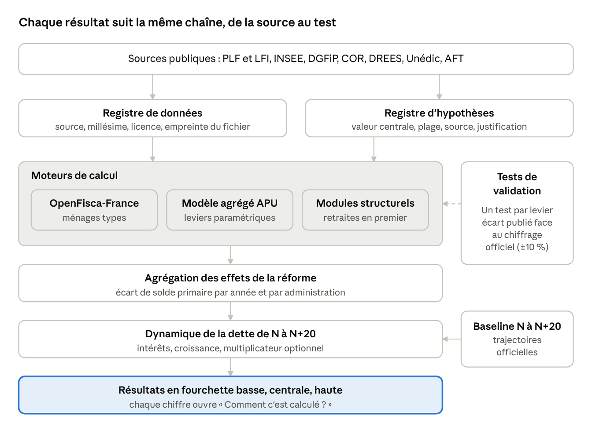
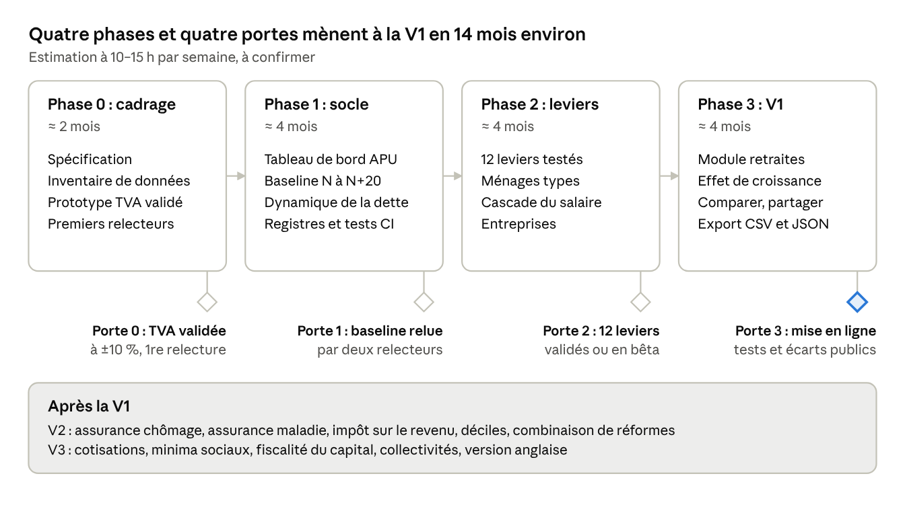

# Simulateur public du budget des administrations publiques françaises — Spécifications

Oct 7, 2026 · @Aurelien

## Vision et décisions actées

Un site public, open source, où n'importe quel Français choisit une réforme et voit son effet chiffré sur les finances publiques, la dette jusqu'à N+20, son salaire et les entreprises, avec chaque source, hypothèse et calcul visibles.

Le projet est sérieux ou il n'existe pas : un levier qui n'est pas validé contre un chiffrage de référence n'est pas publié.

<table>
<colgroup>
<col style="width: 50%" />
<col style="width: 50%" />
</colgroup>
<thead>
<tr class="header">
<th><ul class="task-list">
<li>
<label><input type="checkbox" />Sujet</label>
</li>
</ul></th>
<th>Décision</th>
</tr>
</thead>
<tbody>
<tr class="odd">
<td>Ambition</td>
<td>Outil vérifiable et citable, pas un jouet pédagogique</td>
</tr>
<tr class="even">
<td>Périmètre budgétaire</td>
<td>Toutes les administrations publiques (État, Sécurité sociale, collectivités)</td>
</tr>
<tr class="odd">
<td>Horizon</td>
<td>Dette et solde de N à N+20</td>
</tr>
<tr class="even">
<td>Baseline</td>
<td>Trajectoires officielles réglables ; démographie INSEE, retraites COR</td>
</tr>
<tr class="odd">
<td>Réformes</td>
<td>Paramétriques (simples) et structurelles (un module par réforme, livrés un par un)</td>
</tr>
<tr class="even">
<td>Vérifiabilité</td>
<td>Chaque levier testé contre un chiffrage officiel ou académique ; écart publié ; tolérance ±10 % sur le rendement à 1 an</td>
</tr>
<tr class="odd">
<td>Croissance</td>
<td>Interrupteur de multiplicateur budgétaire dès la V1, désactivé par défaut</td>
</tr>
<tr class="even">
<td>Salaire</td>
<td>Brut, net avant impôt, net après impôt, coût employeur</td>
</tr>
<tr class="odd">
<td>Ménages</td>
<td>Ménages types en V1, agrégats par décile en V2</td>
</tr>
<tr class="even">
<td>Entreprises</td>
<td>Charge fiscale et sociale par taille et secteur, sans effet comportemental</td>
</tr>
<tr class="odd">
<td>Neutralité</td>
<td>Aucune « meilleure réforme », aucun score</td>
</tr>
<tr class="even">
<td>Licence et équipe</td>
<td>Open source dès le début ; développement en solo</td>
</tr>
<tr class="odd">
<td>Validation externe</td>
<td>Relecteurs sollicités (OpenFisca, IPP, économistes), retours publiés</td>
</tr>
<tr class="even">
<td>Langue</td>
<td>Français d'abord, anglais plus tard</td>
</tr>
</tbody>
</table>

## Périmètre : V1, V2, V3

La V1 est volontairement étroite : peu de leviers, tous validés, plus un premier module structurel (retraites). Elle est estimée à 12–18 mois en solo.

| Version | Contenu                                                                                                                                                                                                                                                                                                                                                                                                                                                         | Exclu                                                           |
|---------|-----------------------------------------------------------------------------------------------------------------------------------------------------------------------------------------------------------------------------------------------------------------------------------------------------------------------------------------------------------------------------------------------------------------------------------------------------------------|-----------------------------------------------------------------|
| V1      | Tableau de bord des APU (recettes, dépenses par fonction COFOG, solde, dette, intérêts) ; baseline N à N+20 ; une dizaine de leviers paramétriques validés ; ménages types (brut, net avant impôt, net après impôt, coût employeur) ; entreprises par taille et secteur ; interrupteur multiplicateur ; module structurel retraites ; pages Méthodologie, Sources, Validation ; partage de scénario par lien ; export CSV/JSON ; comparaison de 2 à 3 scénarios | Réformes combinées complexes, déciles, comportements des agents |
| V2      | Modules structurels batch 1 restants (assurance chômage, assurance maladie, impôt sur le revenu) ; combinaison de réformes sans double compte ; agrégats par décile issus de publications officielles ; mode « atteindre un objectif » ; API publique                                                                                                                                                                                                           | Modèle macro complet                                            |
| V3      | Modules structurels batch 2 (cotisations, minima sociaux, fiscalité du capital, collectivités) ; élasticités comportementales sourcées ; version anglaise                                                                                                                                                                                                                                                                                                       | Recommandations, comptes utilisateurs, votes                    |

Hors scope définitif : classer les réformes, proposer une « bonne » politique, prévoir l'économie au-delà d'hypothèses explicites.

## Architecture du calcul

Trois moteurs alimentent une seule agrégation, puis la dynamique de la dette ; les tests de validation portent sur chacun d'eux.

architecture du calcul · 3 moteurs, 1 agrégation, 1 dynamique de la dette

OpenFisca-France calcule les ménages types, le modèle agrégé traite les leviers pour lesquels une assiette nationale suffit, et chaque module structurel apporte son propre modèle. Les registres de données et d'hypothèses alimentent les trois moteurs, et la baseline alimente la dynamique de la dette.

## Dynamique de la dette de N à N+20

La dette à N+20 se calcule en deux couches : une trajectoire de référence sans réforme, puis l'écart créé par la réforme sur le solde primaire, les intérêts et, si l'utilisateur l'active, le PIB.

La dette publique au sens de Maastricht suit, en niveau :

D\_{t+1} = D_t + I_t - PB_t + SFA_t

En ratio de PIB, avec r le taux d'intérêt apparent nominal sur la dette et g la croissance nominale du PIB :

d\_{t+1} = d_t \cdot \frac{1 + r_t}{1 + g_t} - pb_t + sfa_t

Le solde primaire d'un scénario est celui de la baseline plus l'effet de la réforme :

PB_t^{scenario} = PB_t^{baseline} + \Delta PB_t^{reforme}

Le taux apparent r n'est pas un taux de marché unique : il dépend du profil de maturité de la dette existante. Chaque année, une part de la dette est refinancée au taux de marché, ce qui explique que l'effet d'une hausse des taux soit progressif.

**Entrées de la baseline (toutes réglables, toutes sourcées)**

| Variable                           | Source de référence                                            | Réglage utilisateur          |
|------------------------------------|----------------------------------------------------------------|------------------------------|
| Croissance réelle et inflation (g) | Programme pluriannuel, Commission européenne, Banque de France | Oui, curseur avec fourchette |
| Taux de marché et maturité (r)     | Agence France Trésor, courbe des taux                          | Oui                          |
| Démographie                        | Projections INSEE                                              | Scénario central, haut, bas  |
| Retraites                          | Rapport annuel du COR                                          | Scénario COR au choix        |
| Dépenses de santé et dépendance    | Cour des comptes, DREES                                        | Oui                          |
| Ajustements stock-flux (SFA)       | Comptes nationaux INSEE                                        | Non en V1                    |

**Effet de croissance (désactivé par défaut)**

Un interrupteur applique un multiplicateur budgétaire k au solde primaire discrétionnaire :

\Delta Y_t = - k\_{instrument} \cdot \Delta PB_t

Le multiplicateur dépend de l'instrument (dépense publique, impôt sur les ménages, impôt sur les entreprises) et son effet décroît dans le temps. Les valeurs par défaut et leurs fourchettes viennent de la littérature (OFCE, FMI, Banque de France, Commission européenne) et sont citées une à une dans le registre d'hypothèses. L'effet retour sur les recettes passe par l'élasticité des prélèvements au PIB.

**Sorties affichées**

- Dette en points de PIB et en milliards d'euros, de N à N+20, en fourchette basse, centrale et haute

- Solde public et solde primaire annuels

- Charge d'intérêts annuelle

- Écart à la baseline, avec la décomposition : effet direct de la réforme, effet des intérêts cumulés, effet de croissance si activé

La fourchette combine les incertitudes de g, r et du chiffrage de la réforme. Elle est calculée par scénarios bornés (bas, central, haut), pas par une simulation probabiliste dans la V1.

## Moteur salaire et ménages types

Pour chaque ménage type, le site affiche une cascade en quatre étapes, avant et après la réforme, avec l'écart ligne par ligne.

1.  **Coût total employeur** : salaire brut plus cotisations patronales, moins les allègements (réduction générale, etc.)

2.  **Salaire brut**

3.  **Salaire net avant impôt** : brut moins cotisations salariales, CSG et CRDS

4.  **Salaire net après impôt** : net avant impôt moins impôt sur le revenu, plus prestations et crédits d'impôt

Le calcul est fait par OpenFisca-France, qui porte la législation socio-fiscale paramétrée et versionnée. Le projet ne recode pas les barèmes : il vérifie ses sorties contre les simulateurs officiels (impots.gouv.fr, Mon-entreprise.urssaf.fr) sur un jeu de cas de test publié.

**Ménages types V1**

| Profil                                  | Ce qu'il permet de voir                         |
|-----------------------------------------|-------------------------------------------------|
| Célibataire au SMIC                     | Effet des allègements et de la prime d'activité |
| Célibataire, salaire médian             | Cas central                                     |
| Cadre célibataire, 2 à 3 fois le médian | Haut du barème, plafonds de cotisations         |
| Couple, 2 enfants, 2 salaires           | Quotient familial, allocations                  |
| Famille monoparentale, 1 enfant         | Prestations sous conditions de ressources       |
| Indépendant                             | Cotisations hors salariat                       |
| Retraité, pension médiane               | CSG, fiscalité des pensions                     |
| Étudiant ou apprenti                    | Aides, exonérations                             |

L'utilisateur peut aussi saisir son propre profil. Le calcul se fait sans stockage de données personnelles : rien n'est enregistré côté serveur.

**Incidence des cotisations patronales**

Savoir qui supporte réellement une cotisation patronale (le salarié par des salaires plus bas, l'entreprise par ses marges, le consommateur par les prix) est une question disputée. Un réglage visible fixe la part répercutée sur le salaire. Par défaut : incidence comptable (l'employeur paie), avec une option « répercutée sur le salaire à X % » et sa justification académique citée. Le résultat est toujours montré dans les deux lectures.

**Pouvoir d'achat**

Le net après impôt n'inclut pas l'effet des prix. Pour les réformes de TVA et d'accises, un indicateur séparé estime la variation de dépense incompressible à partir des budgets de famille (INSEE).

## Leviers paramétriques V1

Douze leviers, choisis parce qu'ils pèsent lourd dans les APU et qu'ils ont des chiffrages officiels publics contre lesquels se tester. Les références de validation sont à confirmer édition par édition en phase 0 ; aucun chiffre n'est repris de mémoire dans le modèle.

| \#  | Levier                                 | Ce que l'utilisateur règle                                                | Moteur de calcul                                  | Référence de validation                                             |
|-----|----------------------------------------|---------------------------------------------------------------------------|---------------------------------------------------|---------------------------------------------------------------------|
| 1   | TVA                                    | Taux normal, réduits, super-réduit                                        | Agrégé (assiette consommation, comptes nationaux) | Évaluations de rendement dans Voies et Moyens (PLF)                 |
| 2   | Impôt sur le revenu                    | Tranches, taux, plafond du quotient familial, décote                      | OpenFisca + données DGFiP                         | Voies et Moyens ; TAXIPP (IPP)                                      |
| 3   | Impôt sur les sociétés                 | Taux normal, taux PME, seuils                                             | Agrégé (statistiques DGFiP)                       | Voies et Moyens ; rapports du Conseil des prélèvements obligatoires |
| 4   | CSG                                    | Taux par type de revenu (activité, capital, retraite)                     | OpenFisca + agrégé                                | Voies et Moyens ; chiffrages ACOSS                                  |
| 5   | Cotisations patronales                 | Taux, réduction générale, seuils                                          | OpenFisca                                         | Chiffrages Urssaf / ACOSS ; Cour des comptes                        |
| 6   | Accises et taxes énergie               | Taux sur carburants, tabac, alcool                                        | Agrégé                                            | Voies et Moyens                                                     |
| 7   | Niches fiscales                        | Suppression, plafonnement ou réduction d'une dépense fiscale du catalogue | Agrégé par dispositif                             | Voies et Moyens, tome 2 (coût des dépenses fiscales)                |
| 8   | Crédits par mission                    | Gel ou variation en % d'une mission du budget                             | Agrégé (LFI par mission et COFOG)                 | Annexes budgétaires du PLF                                          |
| 9   | Rémunérations publiques                | Point d'indice, effectifs                                                 | Agrégé                                            | Annexe « Rémunérations de la fonction publique » ; Cour des comptes |
| 10  | Indexation des pensions et prestations | Règle de revalorisation (inflation, salaires, gel)                        | Agrégé + trajectoire COR                          | Rapport annuel du COR ; CNAV ; CNAF                                 |
| 11  | Minima et prime d'activité             | Montants, barèmes                                                         | OpenFisca                                         | DREES ; CNAF                                                        |
| 12  | Dotations aux collectivités            | Variation de la DGF et des compensations                                  | Agrégé                                            | Annexe « Transferts financiers de l'État aux collectivités » ; DGCL |

**Règle de publication d'un levier**

Un levier passe en production seulement s'il remplit les trois conditions suivantes, toutes visibles sur la page « Validation » :

- Il reproduit le chiffrage officiel de référence à ±10 % sur le rendement à 1 an, sur au moins deux millésimes lorsque deux existent

- Il est confronté à une source indépendante (IPP, OFCE, Cour des comptes, Commission européenne) et l'écart est publié

- Son jeu de tests automatisés tourne à chaque modification du code et des données

Un levier qui échoue reste en « bêta, non validé », visible mais avec un bandeau explicite, ou reste hors du site.

## Modules structurels

Chaque réforme structurelle est un module autonome, avec sa fiche (questions posées, modèle, données, validation) et sa propre porte de publication. Un module n'entre dans le site que lorsqu'il a passé les mêmes tests que les leviers paramétriques. Les retraites ouvrent la série, parce que les données du COR sont les plus complètes et que l'enjeu budgétaire est majeur.

**Lot 1 (priorité)**

| Ordre | Module                          | Réformes simulables                                                                                 | Approche de calcul                                                         | Validation visée                                                            | Version |
|-------|---------------------------------|-----------------------------------------------------------------------------------------------------|----------------------------------------------------------------------------|-----------------------------------------------------------------------------|---------|
| 1     | Retraites                       | Âge légal, durée de cotisation, indexation, taux de remplacement, régime à points, régimes spéciaux | Modèle de cohortes avec démographie INSEE, calé sur les projections du COR | Scénarios et variantes publiés par le COR ; rapports de la Cour des comptes | V1      |
| 2     | Impôt sur le revenu (structure) | Impôt à taux unique, individualisation, fusion IR et CSG, suppression du quotient familial          | OpenFisca sur ménages types, extrapolation par agrégats DGFiP publiés      | TAXIPP ; Voies et Moyens                                                    | V2      |
| 3     | Assurance chômage               | Taux de remplacement, durée, dégressivité, conditions d'affiliation, cotisations                    | Modèle de flux d'allocataires calé sur les données Unédic et DARES         | Chiffrages Unédic                                                           | V2      |
| 4     | Assurance maladie               | Ticket modérateur, franchises, panier de soins, trajectoire de l'ONDAM                              | Modèle de dépenses par poste, élasticités sourcées                         | Comptes de la santé (DREES) ; rapport Charges et produits de la CNAM        | V2      |

**Lot 2**

| Module               | Réformes simulables                                                      | Principale difficulté                       |
|----------------------|--------------------------------------------------------------------------|---------------------------------------------|
| Cotisations          | Transfert vers la CSG ou la TVA (« TVA sociale »), réforme de l'assiette | Incidence économique très disputée          |
| Minima sociaux       | Fusion des minima, revenu universel, individualisation                   | Non-recours, interactions entre prestations |
| Fiscalité du capital | Prélèvement forfaitaire contre barème, IFI, droits de succession         | Comportements d'optimisation, données rares |
| Collectivités        | Fiscalité locale, dotations, compensations                               | Hétérogénéité entre territoires             |

**Contrainte de données**

Les micro-données d'enquête (ERFS, par exemple) ne sont pas publiables. Les modules du lot 1 s'appuient donc sur des ménages types et sur des agrégats publiés, et la V2 produit des résultats par décile à partir de publications officielles plutôt que de micro-données. Un module qui exigerait des données non accessibles est reporté, et cette limite est écrite dans sa fiche.

## Données, modèle de données et registre d'hypothèses

Toute valeur affichée remonte à une ligne du registre de données ou du registre d'hypothèses, et chaque ligne a une source, un millésime et une licence.

**Sources principales**

| Domaine                       | Sources publiques                                                                                       |
|-------------------------------|---------------------------------------------------------------------------------------------------------|
| Budget de l'État              | PLF et LFI, annexes budgétaires, Voies et Moyens, budget.gouv.fr, data.gouv.fr, comptes publics (DGFiP) |
| Comptabilité nationale et APU | INSEE (comptes des APU, COFOG), Eurostat                                                                |
| Protection sociale            | DREES, CNAV, CNAF, Urssaf/ACOSS, Unédic, rapport du COR                                                 |
| Ménages                       | INSEE (budgets de famille, revenus), statistiques DGFiP sur l'IR                                        |
| Entreprises                   | INSEE (ESANE), DGFiP, Banque de France                                                                  |
| Dette et taux                 | Agence France Trésor, Banque de France                                                                  |
| Législation socio-fiscale     | OpenFisca-France (paramètres versionnés)                                                                |
| Projections                   | INSEE (démographie), Commission européenne, programme pluriannuel de finances publiques                 |

**Modèle de données (entités principales)**

| Entité            | Contenu                                                                                                 |
|-------------------|---------------------------------------------------------------------------------------------------------|
| source            | Nom, URL, éditeur, date de publication, millésime, licence                                              |
| dataset           | Série ou tableau extrait d'une source, méthode de transformation, empreinte (hash) du fichier           |
| assumption        | Identifiant, libellé, valeur par défaut, plage, source, justification, instruments concernés            |
| lever             | Identifiant, paramètres réglables, moteur, statut de validation (validé, bêta, non publié)              |
| validation_test   | Levier, référence officielle, valeur de référence, valeur du modèle, écart, millésime, date d'exécution |
| scenario          | Liste de leviers et de valeurs, hypothèses modifiées, version du modèle, version des données            |
| result            | Scénario, indicateur, année, valeur basse, centrale et haute, décomposition                             |
| household_profile | Paramètres du ménage type (revenus, composition, statut)                                                |

**Règles de gestion**

- Chaque scénario enregistre la version du modèle et des données : le lien partagé reproduit toujours le même résultat

- Les données brutes sont conservées telles que téléchargées ; seules des transformations scriptées et versionnées produisent les tables du modèle

- Un changement de loi de finances donne lieu à une montée de version datée, avec journal des modifications publié

- Chaque hypothèse a une valeur centrale et une plage ; les trois résultats (bas, central, haut) en découlent

## Transparence et validation externe

La crédibilité du site repose sur un engagement simple : tout lecteur peut refaire le calcul et voir où le modèle se trompe.

**Ce que chaque résultat montre**

- Un bouton « Comment c'est calculé ? » qui ouvre la chaîne complète : paramètre modifié, assiette, rendement brut, ajustements, résultat net

- Les hypothèses utilisées, avec leur valeur, leur plage et leur source

- Les données utilisées, avec millésime et lien

- La fourchette basse, centrale et haute, jamais un chiffre unique

- Le statut de validation du levier et son écart avec la référence officielle

**Pages permanentes**

| Page                      | Contenu                                                                 |
|---------------------------|-------------------------------------------------------------------------|
| Méthodologie              | Formules, périmètre de validité, limites connues                        |
| Sources et données        | Registre complet, avec licence et date de téléchargement                |
| Hypothèses                | Registre des hypothèses, filtrable                                      |
| Validation                | Tableau des tests par levier : référence, valeur du modèle, écart, date |
| Journal des modifications | Changements de modèle, de données et de loi de finances                 |
| Relectures                | Retours des relecteurs externes et réponses apportées                   |

**Open source**

Le code, les tests et les scripts de données sont publics dès le premier jour. Les tests automatisés reproduisent les chiffrages de référence, et l'intégration continue publie leur résultat. Les erreurs trouvées par des tiers sont traitées en public.

**Validation externe**

Vous avez accepté de solliciter des relecteurs et de publier leurs retours. Proposition de calendrier :

1.  Phase 0 : présenter la spécification et le premier levier validé (TVA) à la communauté OpenFisca et à un ou deux économistes des finances publiques

2.  Avant la V1 : relecture de la baseline de dette et du module retraites par au moins deux relecteurs indépendants

3.  Après chaque nouveau module : demande de relecture, retours publiés tels quels sur la page « Relectures »

**Neutralité**

Le site n'affiche ni score, ni classement, ni « meilleure réforme ». Le vocabulaire des intitulés est descriptif (« hausse de 1 point du taux normal de TVA », pas « effort fiscal »). Un tiers relit les libellés des leviers avant publication pour repérer les formulations orientées. Mentions légales : outil d'information, pas une prévision officielle.

## Architecture technique et écrans

La stack vise un seul développeur : peu de pièces, des outils standards, et un coût d'hébergement de quelques dizaines d'euros par mois, à confirmer.

**Stack proposée**

| Couche                   | Choix                                                                                                                      | Raison                                                                 |
|--------------------------|----------------------------------------------------------------------------------------------------------------------------|------------------------------------------------------------------------|
| Moteur socio-fiscal      | Python, OpenFisca-France                                                                                                   | Législation déjà paramétrée et versionnée, utilisée par des chercheurs |
| Modèle agrégé et modules | Python (pandas, NumPy), tests avec pytest                                                                                  | Même langage que le moteur, calcul lisible et testable                 |
| API                      | FastAPI, sans état, sans journalisation des profils saisis                                                                 | Les profils personnels ne sont jamais stockés                          |
| Données                  | Fichiers CSV versionnés (décision du 30 octobre 2026 : lisibles en revue de code, à la place du Parquet prévu), scripts d'extraction et de transformation rejouables ; PostgreSQL pour les scénarios partagés | Reproductibilité et simplicité                                         |
| Front                    | TypeScript, React (Next.js), graphiques interactifs                                                                        | Mobile first, partage par lien                                         |
| Intégration continue     | GitHub Actions : tests de validation à chaque modification                                                                 | Les écarts avec les chiffrages officiels sont recalculés en continu    |
| Hébergement              | Front statique sur CDN, API sur un petit serveur ou conteneur, cache des scénarios courants                                | Coût faible, tenue en cas de pic de trafic                             |
| Accessibilité et langue  | Conformité RGAA visée, textes externalisés pour préparer l'anglais                                                         | La V1 est en français ; la traduction ne demande alors pas de refonte  |

**Écrans de la V1**

| Écran                      | Rôle                                 | Contenu clé                                                                                               |
|----------------------------|--------------------------------------|-----------------------------------------------------------------------------------------------------------|
| Accueil / budget des APU   | Situer la photo actuelle             | Recettes, dépenses par fonction, solde, dette, intérêts, évolution sur 20 ans                             |
| Catalogue de réformes      | Choisir un levier ou un module       | Liste par thème, statut de validation, description neutre                                                 |
| Simulateur                 | Régler une réforme                   | Curseurs et champs, impact budgétaire annuel, dette de N à N+20 en fourchette, interrupteur de croissance |
| Impact sur les ménages     | Voir l'effet sur un salaire          | Cascade coût employeur, brut, net avant impôt, net après impôt, avant et après réforme                    |
| Impact sur les entreprises | Voir la charge par taille et secteur | Charge fiscale et sociale avant et après                                                                  |
| Comparaison                | Confronter 2 à 3 scénarios           | Tableau et courbes côte à côte, lien de partage, export CSV et JSON                                       |
| Comment c'est calculé ?    | Auditer un résultat                  | Chaîne de calcul, hypothèses, données, sources, statut du test                                            |
| Pages de référence         | Vérifier le projet                   | Méthodologie, Sources, Hypothèses, Validation, Journal, Relectures, Glossaire                             |

**Parcours simple et avancé**

Par défaut, l'utilisateur voit une phrase de réforme, un résultat central et une fourchette. Un clic ouvre le mode avancé : toutes les hypothèses réglables, leur source, et la décomposition du résultat.

## Phases et calendrier

La V1 demande environ 14 mois à 10–15 heures par semaine ; on ne passe à la phase suivante que si la porte est franchie.

feuille de route · 4 phases, 4 portes

Le calendrier est une estimation à confirmer avec votre disponibilité réelle. Un retard sur une porte repousse la suite : il vaut mieux publier moins de leviers, tous testés.

**Premières actions (phase 0)**

1.  Créer le dépôt public, choisir la licence et poser la structure du projet

2.  Installer OpenFisca-France et reproduire un ménage type contre les simulateurs officiels

3.  Rassembler, pour les 12 leviers, les chiffrages officiels des trois derniers millésimes du PLF

4.  Construire le prototype TVA : assiette, rendement, comparaison avec le chiffrage officiel

5.  Rédiger le modèle de fiche d'un levier et le premier registre d'hypothèses

6.  Dresser la liste de 5 à 10 relecteurs potentiels

## Risques et points ouverts

Le principal risque est le temps : cette spécification représente un travail de 12 à 18 mois en solo, et la qualité de validation ne se négocie pas. Les autres risques sont gérables s'ils sont traités dès la phase 0.

| Risque                                                      | Probabilité | Impact | Parade                                                                    |
|-------------------------------------------------------------|-------------|--------|---------------------------------------------------------------------------|
| Écart important avec les chiffrages officiels sur un levier | Élevée      | Moyen  | Règle de publication à ±10 %, statut « bêta » affiché, écart publié       |
| Accusation de biais                                         | Moyenne     | Élevé  | Neutralité du vocabulaire, relecture externe, code et données ouverts     |
| Épuisement du projet solo                                   | Élevée      | Élevé  | V1 étroite, un levier ou module à la fois, jalons publics                 |
| Mise à jour annuelle de la loi de finances                  | Certaine    | Moyen  | Processus de montée de version daté, tests de non-régression              |
| Double comptage entre réformes combinées                    | Moyenne     | Moyen  | Combinaison reportée en V2, avec tests d'interaction                      |
| Données inaccessibles (micro-données)                       | Moyenne     | Moyen  | Ménages types et agrégats publiés ; limite écrite dans la fiche du module |
| Hypothèses de long terme contestées (g, r, multiplicateurs) | Certaine    | Moyen  | Fourchettes, plages sourcées, interrupteur désactivé par défaut           |
| Pic de trafic à la mise en ligne                            | Faible      | Faible | Résultats courants en cache, hébergement statique en front                |

**Points à confirmer avec vous**

J'ai appliqué mes valeurs par défaut sur ces points ; dites-moi si l'un d'eux doit changer.

- [ ] Temps disponible par semaine et date cible de la V1 (le calendrier de la section suivante suppose environ 10 à 15 heures par semaine)

- [ ] Backend Python avec OpenFisca-France (par défaut oui)

- [ ] Budget d'hébergement et de données (par défaut quelques dizaines d'euros par mois)

- [ ] Financement éventuel (bénévole, dons, subvention) : à trancher avant la mise en ligne, car il influence la perception de neutralité

- [ ] Nom du projet et du domaine

- [ ] Qui relit en premier : liste de 5 à 10 relecteurs potentiels à établir en phase 0
